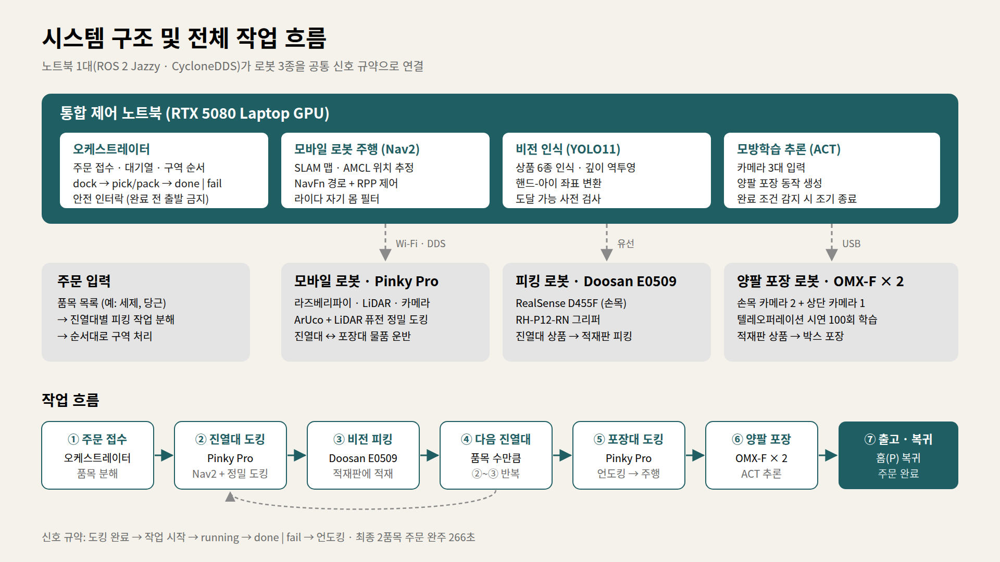

# 📦 COUPING — 이기종 다중 로봇 주문 처리 시스템

> **모바일 로봇(Pinky Pro) + 피킹 로봇(Doosan E0509) + 양팔 포장 로봇(OMX-F × 2)** 이 하나의 주문을 받아 피킹 → 운반 → 포장 → 복귀까지 자동으로 처리하는 스마트 물류 시스템

노트북 1대(ROS 2 Jazzy)가 로봇 3종을 공통 신호 규약으로 연결하며, 2품목 주문을 **266초**에 완주했습니다.



---

## 🔄 작업 흐름


1. **주문 접수**: 고객 웹 화면에서 상품 선택 → 품목을 진열대별 작업으로 분해
2. **진열대 도킹**: 핑키가 Nav2로 진열대 앞까지 주행 후 ArUco + LiDAR 퓨전으로 정밀 도킹
3. **비전 피킹**: 두산 로봇팔이 YOLO로 상품을 찾아 수평으로 집고 핑키 적재함에 담음 (품목 수만큼 2~3 반복)
4. **포장대 도킹**: 언도킹(후진) 후 포장대로 이동해 도킹
5. **양팔 포장**: OMX 양팔이 모방학습(ACT) 정책으로 박스 포장
6. **복귀**: 포장 완료 신호 수신 후 언도킹 → 홈(P) 복귀, 다음 주문 처리

**신호 규약**: 도킹 완료 → 작업 시작 → `running` → `done` | `fail:<이유>` → 언도킹 (완료 신호 전에는 출발하지 않는 인터락)

---

## 🤖 로봇 구성

| 로봇 | 하드웨어 | 역할 | 핵심 기술 |
| :--- | :--- | :--- | :--- |
| **모바일 로봇** | Pinky Pro (RPi 5, LiDAR, 카메라) | 진열대 ↔ 포장대 운반, 정밀 도킹 | SLAM Toolbox, Nav2(NavFn + RPP), 카메라-LiDAR 퓨전 도킹 |
| **피킹 로봇** | Doosan E0509 + RH-P12-RN 그리퍼, RealSense D455F | 진열대 상품 → 적재함 피킹 | YOLO11s 인식, 깊이 역투영, 핸드-아이 캘리브레이션 |
| **양팔 포장 로봇** | OpenManipulator-X × 2 (손목 카메라 2 + 상단 카메라 1) | 적재함 상품 → 박스 포장 | LeRobot ACT 모방학습 (시연 100회) |

---

## ✨ 핵심 기술

- **SLAM / Nav2 튜닝**: 경기장(1.5 m × 2.25 m) 맞춤 파라미터. 코스트맵 해상도 0.02 m, 비대칭 적재판 풋프린트, 라이다 자기 몸 필터(`scan_self_filter.py`)로 적재판 오감지 제거
- **카메라-LiDAR 퓨전 도킹**: 벽 각도는 LiDAR, 거리는 LiDAR + 카메라 가중 평균, 좌우 위치는 카메라(ArUco)로 추정해 칼만 필터로 융합. 목표 거리 0.10 m, 중심 허용 오차 0.02 m
- **수평 접근 피킹**: YOLO 박스 중심 픽셀 + 깊이로 3D 위치를 구하고, 핸드-아이 캘리브레이션으로 로봇 좌표로 변환. 티칭한 수평 자세로 그리퍼 방향을 고정하고 움직이기 전 모든 단계의 도달 가능 여부를 검사
- **모방학습 포장 + 조기 종료**: ACT 추론 중 그리퍼 열림으로 완료를 감지해 포장 구간 87.7 s → 36.8 s 단축
- **통합 오케스트레이션**: 주문 대기열, 단계별 타임아웃, 정지·재개, 실패 시 대기열 일시정지

---

## 📊 결과

| 항목 | 결과 |
| :--- | :--- |
| 2품목 주문 전체 완주 (세제 + 당근) | 404 s → 340 s → 305 s → **266 s** (4회 연속 완주) |
| 266 s 구간 내역 | 도킹 10.6 / 14.6 / 11.9 s, 피킹 42.3 / 45.2 s, OMX 36.9 s, 복귀 19.0 s |
| YOLO11s 상품 인식 (6종, 검증셋) | mAP50 0.995, mAP50-95 0.955 |
| 핸드-아이 캘리브레이션 | 검증 최대 오차 9.86 mm |
| 부분 연동 성공률 (2차 연동 테스트) | 모바일 + 피킹 9/16, 모바일 + 포장 2/10 |

---

## 📁 저장소 구조

| 폴더 | 내용 | 문서 |
| :--- | :--- | :--- |
| `amr/pinky_navigation` | 경기장 SLAM 맵, Nav2 파라미터·런치 | [amr/README.md](amr/README.md) |
| `amr/pinky_precision_docking` | 카메라-LiDAR 퓨전 정밀 도킹, 경기장 미션 | [README](amr/pinky_precision_docking/README.md) |
| `doosan/` | 비전 인식·피킹 노드(`couping` 패키지), 캘리브레이션, YOLO 학습 도구 | [doosan/README.md](doosan/README.md) |
| `omx/` | 양팔 OMX LeRobot 설정, ACT 실행 스크립트, 조기 종료 패치 | [omx/README.md](omx/README.md) |
| `integration/` | 오케스트레이터, 웹 UI, 주문 실행 스크립트(`order_run.sh`) | [integration/README.md](integration/README.md) |
| `sim/` | Gazebo 핑키 디지털 트윈 | [README](sim/pinky_gz_sim_twin/README.md) |
| `docs/` | 작업 기록, 도킹 설계 문서, 발표 자료 | |

---

## 🚀 실행

```bash
# 빌드 (~/couping_ws/src 에 패키지를 두고)
colcon build --symlink-install && source install/setup.bash
```

**로봇 없이 신호 흐름과 웹 UI만 확인**
```bash
ros2 launch couping_integration integration.launch.py dsr_bringup:=false pinky:=false omx:=false fake:=true
```
- 고객 화면 `http://<노트북 IP>:8080/`, 관리자 화면 `http://<노트북 IP>:8080/admin`

**실제 주문 한 건** (두산·비전·OMX·Nav2·핑키 bringup·도킹 노드를 먼저 띄운 뒤)
```bash
PINKY=<핑키 번호> bash integration/scripts/order_run.sh tide,carrot
```
- `ROS_DOMAIN_ID` = 핑키 번호 (`integration/tools/dds_env.sh`)
- 웹 주문으로 실행하려면 `integration/tools/web_order_run.py` 사용
- 상세 순서와 옵션은 [integration/README.md](integration/README.md) 참고

---

## 🛠️ 기술 스택

- **OS / 미들웨어**: Ubuntu 24.04, ROS 2 Jazzy, CycloneDDS
- **주행**: SLAM Toolbox, Nav2 (AMCL, NavFn, Regulated Pure Pursuit)
- **매니퓰레이션 / AI**: Doosan ROS 2 드라이버, Ultralytics YOLO11, LeRobot ACT (PyTorch), OpenCV
- **웹 UI**: Python HTTP 서버 + SSE, HTML / JavaScript (추가 설치 없음)
