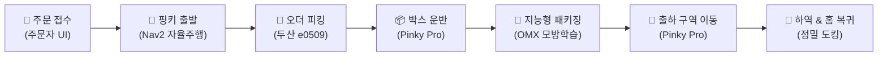

# 📦 E2E Multi-Robot Order Fulfillment System

> **이기종 다중 로봇(AMR + 협동로봇 + 매니퓰레이터)과 웹 UI 기반의 엔드투엔드(E2E) 스마트 물류 자동화 시스템**

주문 접수부터 **오더 피킹 → 자율 운반 → 지능형 패키징 → 출하(Loading) 및 복귀**까지 전 과정을 무인 자동화합니다.

---

## 🔄 워크플로우 (Scenario Workflow)

1. **주문 접수**: 사용자가 주문자 UI에서 상품 선택 및 주문 제출 → 작업 대기열(Queue) 자동 등록
2. **피킹 구역 이동**: AMR(Pinky Pro)이 오더 피킹 스테이션으로 Nav2 자율주행 이동
3. **오더 피킹**: 두산로봇팔 e0509가 상품을 인식하여 핑키 적재함으로 피킹
4. **패키징 구역 운반**: 피킹 완료 후 Pinky Pro가 패키징 구역으로 박스 운반
5. **지능형 패키징**: 모방학습(Imitation Learning) 기반 OpenManipulator-X가 박스 덮개 닫기 수행
6. **출하 및 복귀**: 포장 완료된 박스를 Loading 구역으로 운반 및 하역 후 홈 스테이션으로 자동 복귀

---

## 🤖 로봇 역할 구성 (Hardware & Role)

| 구분 | 하드웨어 | 주요 역할 | 핵심 기술 |
| :--- | :--- | :--- | :--- |
| **이동 로봇 (AMR)** | **Pinky Pro** | 구역 간 물류 운반, 스테이션 도킹 | 2D SLAM, Nav2 자율주행, 정밀 도킹 |
| **피킹 로봇** | **두산 e0509** | 상품 오더 피킹 (적재함 적재) | 협동로봇 제어, 비전 기반 물체 파지 |
| **패키징 로봇** | **OpenManipulator-X** | 박스 닫기 및 포장 | 모방학습 (Imitation Learning) |

---

## 💻 시스템 & UI 구성 (Software & Monitoring)

- **주문자 UI**: 상품 주문 및 실시간 주문 처리 진행 상태 확인
- **관리자 관제 UI (FMS)**: 
  - 다중 로봇 실시간 위치 및 상태 모니터링
  - 주문 대기열(Queue) 및 작업 스케줄링 관리
- **통신 / 미들웨어**: ROS 2 Jazzy, DDS 통신, WebSocket / REST API 연동

---

## 🛠️ 기술 스택 (Tech Stack)

- **OS / Middleware**: Ubuntu 24.04, ROS 2 Jazzy, CycloneDDS
- **Navigation & SLAM**: Nav2, SLAM Toolbox
- **Manipulation & AI**: Doosan ROS 2 Driver, OpenManipulator-X, PyTorch / Imitation Learning
- **Web & Interface**: HTML/CSS/JavaScript, React / Node.js
