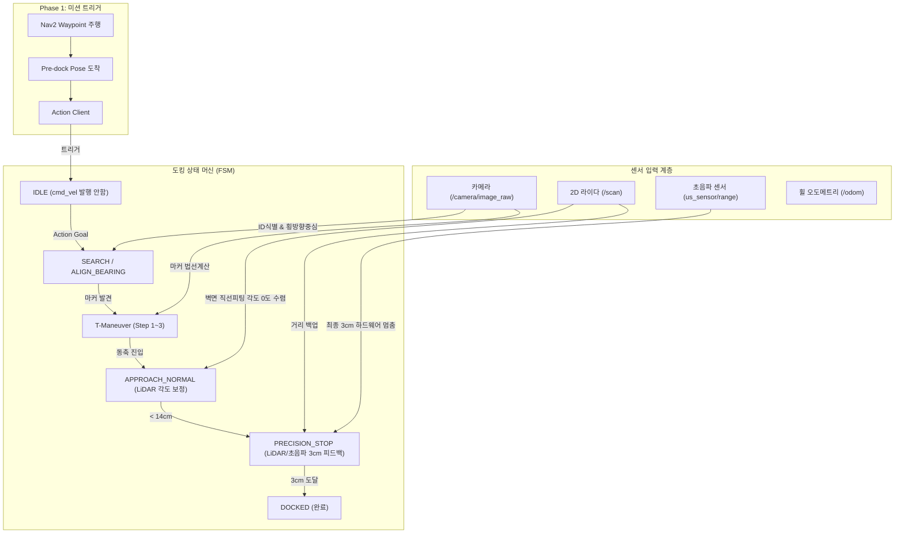

# 📋 Pinky Pro 다중 센서 융합(Camera + LiDAR + Ultrasonic) 정밀 도킹 개선 계획서

본 문서는 추후 실 로봇(Pinky Pro) 사용이 가능한 시점에 즉시 적용 및 검증할 수 있도록, **Nav2 웨이포인트 주행 연동 트리거**, **2D 라이다(`/scan`) 벽면 정밀 정렬**, **초음파 센서(`us_sensor/range`) 기반 초근접 3cm 멈춤 제어**를 단계별로 구현하기 위한 종합 기술 설계서입니다.

---

## 1. 배경 및 개선 목표

### 현재 시스템 한계 (v3.8 기준)
1. **각도 오차 잔여 (3~4°)**: 단안 카메라 PnP 영상 연산 노이즈 및 마커 픽셀 양자화 오차로 인해 완전한 $0.0^\circ$ 수직 정렬의 한계 존재.
2. **초근접(<14cm) 블라인드 의존 (`BLIND_PUSH`)**: 14cm 이하에서 마커가 카메라 시야를 벗어나 바퀴 오도메트리 적분으로만 11cm를 전진하여, 바퀴 슬립(Slip) 시 3cm 도킹 오차 발생.
3. **독립 실행 구조**: Nav2 웨이포인트 주행 후 도킹으로 자동 인계되는 트리거 인터페이스 부재.

### 개선 후 목표 성능 지표
- **벽면 각도 오차**: $3\sim 4^\circ \longrightarrow$ **$\le 0.5^\circ$ 이내 (라이다 벽면 법선 피팅)**
- **도킹 멈춤 거리**: $3\text{cm} \pm 1\text{cm} \longrightarrow$ **$3\text{cm} \pm 2\text{mm}$ (라이다/초음파 직접 피드백)**
- **제어권 자동 인계**: Nav2 완료 후 Action/Service 트리거로 자동 도킹 수행 (평상시 `/cmd_vel` 충돌 방지)

---

## 2. 센서 역할 분담 및 시스템 아키텍처



---

## 3. 단계별 상세 구현 계획 (Phase 1 ~ 4)

### [Phase 1] Nav2 연동을 위한 제어권 분리 및 Action Server 구현

> [!IMPORTANT]
> Nav2 주행 중 도킹 노드가 `/cmd_vel`을 발행하면 제어권 충돌(로봇 떨림 현상)이 발생하므로, 트리거 수신 전까지는 모터를 제어하지 않는 `IDLE` 상태가 필수적입니다.

1. **상태 머신에 `IDLE` 상태 추가**:
   - 노드 기동 시 기본 상태를 `IDLE`로 설정.
   - `IDLE` 상태에서는 어떠한 Twist 메시지도 발행하지 않음 (`self.cmd_vel_pub.publish()` 차단).
2. **ROS 2 Action Interface 정의 (`pinky_docking_msgs/action/Dock.action`)**:
   ```text
   # Goal
   int32 target_marker_id     # -1: 자동 락온, 특정 ID 지정 가능
   float32 target_distance    # 최종 도킹 거리 (기본값: 0.03m)
   ---
   # Result
   bool success
   string message
   float32 final_distance
   float32 final_angle_error
   ---
   # Feedback
   string state
   float32 current_distance
   float32 angle_error_deg
   ```
3. **Nav2 Python 네비게이션 스크립트 연결**:
   - `goToPose(pre_dock_pose)` 완료 감지 $\rightarrow$ `dock_client.send_goal_async()` 자동 연동.

---

### [Phase 2] 2D LiDAR (`/scan`) 벽면 정밀 피팅 & 잔여 각도(3~4°) 완전 제거

1. **라이다 토픽 구독 및 전방 섹터 필터링**:
   - 구독 토픽: `/scan` (`sensor_msgs/msg/LaserScan`)
   - 로봇 전방 $\pm 25^\circ$ 범위, 유효 거리 $0.15\text{m} \sim 1.0\text{m}$ 이내의 레이저 점들을 로봇 기준 직교좌표계 $(x_i, y_i)$로 변환.
2. **벽면 직선 피팅 (Linear Regression / RANSAC)**:
   - 전방 30~50개 점들에 대해 최소자승법(Least Squares)으로 벽면 직선 모델 $y = ax + b$ 산출.
   - 벽면 법선 각도 오차 추출:
     $$\theta_{lidar\_wall} = \text{atan2}(a, 1) \quad (\text{로봇이 벽과 수직일 때 } 0.0\text{ rad})$$
   - 벽면 수직 거리 추출:
     $$d_{lidar\_wall} = \frac{|b|}{\sqrt{a^2 + 1}}$$
3. **`APPROACH_NORMAL` 구간 이중 제어기 융합**:
   - **횡방향(좌우) 정렬**: 카메라 ArUco Bearing 에러 추종 (마커 중심선 이탈 방지)
   - **자세(Heading) 정렬**: 라이다 $\theta_{lidar\_wall}$를 이용해 $0.0^\circ$ 수렴 조향 ($\omega = -K_{lidar} \cdot \theta_{lidar\_wall}$)
   - **효과**: 기존 카메라 단독 3~4° 잔여 각도가 **$0.5^\circ$ 이내로 완벽 보정**됨.

---

### [Phase 3] 초근접(<14cm ~ 3cm) 라이다 & 초음파 센서 정밀 밀착 제어

> [!TIP]
> 핑크 프로의 초음파 센서(`us_sensor/range`)는 최소 감지 거리가 `0.02m`($2\text{cm}$)로 하드웨어 노드(`pinky_sensor_adc`)에 이미 구현되어 있습니다.

1. **초음파 센서 토픽 구독**:
   - 토픽: `us_sensor/range` (`sensor_msgs/msg/Range`)
2. **블라인드 푸시(`BLIND_PUSH`) 전면 개편 $\rightarrow$ `PRECISION_STOP`**:
   - 카메라 마커 시야 이탈 시점($14\text{cm}$)에서 오도메트리 적분 대신 **거리 센서 피드백 루프**로 전환.
   - **이중 센서 셀렉터 (LiDAR + Ultrasonic)**:
     ```python
     # 라이다가 사각지대(range_min)에 도달하기 전까지는 라이다 거리 사용
     # 라이다가 inf/NaN으로 빠지거나 초근접 시 초음파 거리로 스위칭
     if lidar_valid and d_lidar > 0.08:
         current_dist = d_lidar
     elif ultrasonic_valid:
         current_dist = us_range_filtered
     ```
   - **3cm 정밀 감속 정지**:
     - 목표: $d_{target} = 0.03\text{m}$ ($3\text{cm}$)
     - 속도 제어: $v = \text{clamp}(K_p \cdot (current\_dist - 0.03), 0.02, 0.05)$
     - 정지 조건: $current\_dist \le 0.030\text{m}$ 도달 즉시 $v=0, \omega=0$, 도킹 완료(`DOCKED`) 선언.
   - **비상 충돌 방지 (Hard E-stop)**:
     - 초음파 거리 $< 0.02\text{m}$ 감지 시 강제 급제동.

---

### [Phase 4] 파라미터화 및 실 로봇 복귀 시 단계별 검증 절차

#### 1. 파라미터 추가 (`config/docking_params.yaml`)
```yaml
precision_docking_node:
  ros__parameters:
    # Sensor Fusion Flags
    enable_action_server: true       # Nav2 연동 Action Server 활성화
    enable_lidar_alignment: true     # LiDAR 벽면 각도 보정 활성화
    enable_ultrasonic_stop: true     # 초음파 3cm 밀착 피드백 활성화

    # Topics
    scan_topic: "/scan"
    ultrasonic_topic: "us_sensor/range"

    # Tolerances
    lidar_yaw_tolerance: 0.015       # 약 0.8도
    final_dock_distance: 0.03        # 최종 도킹 거리 (3cm)
    ultrasonic_stop_threshold: 0.032 # 초음파 정지 임계값 (3.2cm)
```

#### 2. 실 로봇 복귀 시 단계별 테스트 체크리스트 (Hardware Bringup)
1. **1단계: 단독 센서 토픽 수신 확인**:
   ```bash
   ros2 topic echo /scan --once
   ros2 topic echo us_sensor/range --once
   ```
   - 로봇 앞 10cm, 5cm, 3cm 지점에 벽을 두고 라이다 최소 측정 거리 및 초음파 센서 값의 일치도 확인.
2. **2단계: 라이다 벽면 각도 피팅 모니터링**:
   - 로봇을 벽면에 대해 $15^\circ$ 비스듬히 세우고, 산출된 $\theta_{lidar\_wall}$ 값이 실측 각도와 맞는지 디버그 로그 확인.
3. **3단계: 단독 정밀 도킹 실행 (Camera + LiDAR + US)**:
   - 카메라 T-기동 $\rightarrow$ 라이다 각도 보정 $\rightarrow$ 초음파 3cm 정지 정상 시퀀스 확인.
4. **4단계: Nav2 $\rightarrow$ 도킹 통합 시나리오 테스트**:
   - 맵 상에서 3m 떨어진 위치에서 Waypoint 출발 $\rightarrow$ 충전소 앞 Pre-dock 도착 $\rightarrow$ 정밀 도킹 성공 완수.

---

## 4. 사용자 검토 및 결정 필요 사항 (User Review Required)

> [!IMPORTANT]
> - **인터페이스 표준**: 상위 제어기(Nav2 연동)와의 통신 규격을 **ROS 2 Action (`Dock.action`)**으로 진행할지, 가장 단순한 **ROS 2 Service (`Trigger`)**로 시작할지 결정이 필요합니다. (Action 방식을 적극 권장합니다.)
> - **초음파 센서 캘리브레이션**: `pinky_sensor_adc` 노드 확인 결과 전압 기반 추정 수식(`1.0 * (adc / 4096.0) - 0.03`)을 사용 중이므로, 실제 로봇 복귀 시 자(Ruler)를 대고 3cm, 5cm 실측값과의 오프셋 캘리브레이션을 1회 권장합니다.
