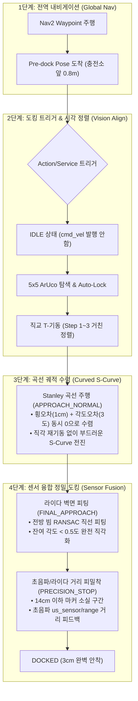

# 🚀 Pinky Pro 통합 정밀 자동 도킹 마스터 플랜 (Master Implementation Plan)

> **목적**: 실 로봇(Pinky Pro) 접근 시 즉시 적용하여, **Nav2 자율주행 $\rightarrow$ 동축 곡선 수렴(S-Curve) $\rightarrow$ 라이다 벽면 정렬 $\rightarrow$ 초음파 3cm 정밀 안착**을 완벽히 수행하는 올인원(All-in-One) 고도화 계획서  
> **대상 패키지**: `pinky_precision_docking`  
> **통합 센서**: Camera (ArUco 5x5) + 2D LiDAR (`/scan`) + Ultrasonic (`us_sensor/range`) + Odometry (`/odom`)

---

## 1. 통합 시스템 아키텍처 & 제어 파이프라인



---

## 2. 세부 구현 단계 (Phase 1 ~ Phase 4)

---

### [Phase 1] Nav2 연동 & 제어권 분리 (`IDLE` & Trigger)

#### 1. 문제 해결
- Nav2 주행 중에 도킹 노드가 `/cmd_vel`을 퍼블리시하여 생기는 **명령어 충돌(로봇 떨림) 원천 방지**.
- 충전소 앞 $0.7\sim 1.0\text{m}$ 지점에 도달하기 전까지 도킹 노드는 **완전 대기(Zero Twist)** 상태를 유지.

#### 2. 구현 명세
- **`DockingState.IDLE` 추가**: 트리거 명령 수신 전까지 속도 명령 퍼블리시를 차단.
- **ROS 2 Service / Action 인터페이스 탑재**:
  - 빠른 적용을 위해 `std_srvs/srv/Trigger` (`/docking/start`, `/docking/cancel`) 제공.
  - 상위 Nav2 Python 시퀀서에서 한 줄로 호출 가능:
    ```python
    # Nav2 목표점(Pre-dock) 도착 후 트리거 호출
    cli = node.create_client(Trigger, '/docking/start')
    cli.call_async(Trigger.Request())
    ```

---

### [Phase 2] 곡선 궤적 수렴 제어기 (Stanley S-Curve Controller)

#### 1. 핵심 원리 (3~4° 잔여 각도 및 1cm 횡오차 소멸)
- T-기동 3단계($90^\circ$ 회전) 완료 후, 미세하게 남은 횡오차(1cm) 때문에 제자리 회전을 하면 차체가 비스듬히 틀어지는 문제를 해결.
- **직각 재기동을 하지 않고**, 전진하면서 차선을 바꾸듯 부드러운 S-곡선으로 마커 법선 축(동축)에 완벽히 합류:

$$\omega = -K_{yaw} \cdot \text{wall\_angle} + K_{lat} \cdot \arctan\left(\frac{k \cdot \text{signed\_lat}}{v_x + 0.01}\right)$$

#### 2. 동작 특성
- 로봇이 오른쪽에 치우치면($signed\_lat > 0$): 좌측으로 완만하게 호(Arc)를 그리며 전진.
- 축에 도달하면($signed\_lat \to 0$): $K_{yaw}$ 항이 작동하여 차체를 벽면과 직각($wall\_angle \to 0$)으로 반대 조향(Counter-steering).
- **결과**: 전진 주행만으로 횡오차 $0\text{cm}$와 각도오차 $0.0^\circ$가 동시에 달성됨.

---

### [Phase 3] 2D LiDAR (`/scan`) 벽면 정밀 법선 피팅

#### 1. 센서 융합 방식
- 구독 토픽: `/scan` (`sensor_msgs/msg/LaserScan`)
- 로봇 전방 $\pm 25^\circ$ 이내, 유효 거리 $0.15\text{m} \sim 0.8\text{m}$의 레이저 점들을 직교좌표계로 변환.
- 최소자승법(Least Squares)으로 전방 벽면 직선 $y = ax + b$ 실시간 피팅.

#### 2. 제어기 반영
- 라이다 기반 벽면 각도 $\theta_{lidar} = \text{atan2}(a, 1)$ 산출.
- 카메라 영상 노이즈와 무관하게 **벽면과의 평행도를 $0.5^\circ$ 이내의 초정밀도로 강제 정렬**.

---

### [Phase 4] 초근접(<14cm ~ 3cm) 라이다 & 초음파 피드백 안착

#### 1. 블라인드 오도메트리(`BLIND_PUSH`) 전면 대체
- 카메라 마커가 시야에서 사라지는 $14\text{cm}$ 이하 구간에서 바퀴 오도메트리 적분(슬립 취약)을 중단.
- 전방 물리적 거리 센서 기반의 **`PRECISION_STOP`** 상태로 전환.

#### 2. 초음파 센서(`us_sensor/range`) 연동
- 핑크 프로 하드웨어 노드(`pinky_sensor_adc`)에서 발행하는 `us_sensor/range` 구독 ($2\text{cm} \sim 3\text{m}$ 측정 가능).
- **제어 로직**:
  ```python
  # 초근접 구간 실시간 감속
  dist_err = current_sensor_dist - 0.03  # 3cm 목표
  if dist_err <= 0.002: # 3cm 도달 (오차 2mm 이내)
      twist.linear.x = 0.0
      twist.angular.z = 0.0
      self.state = DockingState.DOCKED
  else:
      twist.linear.x = max(0.02, min(0.05, 0.4 * dist_err))
  ```
- **하드웨어 비상 브레이크 (E-Stop)**:
  - 초음파 거리 $< 0.02\text{m}$ 감지 시 소프트웨어 즉각 차단으로 충돌 원천 방지.

---

## 3. 설정 파라미터 종합 (`config/docking_params.yaml`)

```yaml
precision_docking_node:
  ros__parameters:
    # 1. 트리거 및 FSM 설정
    start_in_idle: true               # 시작 시 IDLE 상태 대기 (Nav2 충돌 방지)
    trigger_service_name: "/docking/start"
    cancel_service_name: "/docking/cancel"

    # 2. ArUco 마커 설정
    marker_size: 0.06                 # 6cm x 6cm
    target_marker_id: -1              # -1: 자동 락온
    aruco_dictionary_id: "DICT_5X5_250"

    # 3. 곡선 궤적 수렴 게인 (Stanley S-Curve)
    enable_curved_approach: true
    kp_lateral: 1.5                   # 횡방향 동축 수렴 게인
    kp_wall_yaw: 1.8                  # 벽면 직각 평행도 유지 게인
    max_curve_yaw_rate: 0.25          # 곡선 주행 시 최대 각속도 제한 (rad/s)

    # 4. 센서 융합 설정 (LiDAR & Ultrasonic)
    enable_lidar_alignment: true      # 2D 라이다 벽면 정렬 사용
    scan_topic: "/scan"
    lidar_yaw_tolerance: 0.015        # 라이다 각도 허용치 (약 0.8도)

    enable_ultrasonic_stop: true      # 초음파 3cm 정밀 멈춤 사용
    ultrasonic_topic: "us_sensor/range"
    target_distance: 0.03             # 최종 3cm 정지 목표
    distance_tolerance: 0.005         # 5mm 허용오차

    # 5. 속도 제한
    max_linear_vel: 0.08
    min_linear_vel: 0.02
```

---

## 4. 실 로봇 복귀 시 단계별 실행 & 검증 절차 (Hardware Runbook)

로봇 사용이 가능해지면 아래 순서대로 1단계씩 확인하며 즉시 시스템을 가동할 수 있습니다.

### Step 1. 센서 하드웨어 데이터 수신 점검
```bash
# 1) 라이다 데이터 수신 확인
ros2 topic echo /scan --once

# 2) 초음파 센서 데이터 수신 확인 (앞에 손을 대보고 거리 변화 확인)
ros2 topic echo us_sensor/range --once

# 3) 카메라 영상 확인
ros2 topic hz /camera/image_raw/compressed
```

### Step 2. 단독 정밀 도킹 노드 실행 & 서비스 트리거 테스트
```bash
# 터미널 1: 도킹 노드 실행 (IDLE 상태로 대기)
ros2 launch pinky_precision_docking precision_docking.launch.py

# 터미널 2: rqt 디버그 뷰 실행 (/docking/debug_image 선택)
rqt_image_view

# 터미널 3: 도킹 시작 서비스 트리거 호출
ros2 service call /docking/start std_srvs/srv/Trigger
```
- **동작 관찰 포인트**:
  1. 마커가 시야에 들어오면 T-기동 수행 후 복귀.
  2. 복귀 후 억지 제자리 회전 없이 **부드러운 곡선(S-Curve)을 그리며 동축으로 자연스럽게 전진**.
  3. 라이다로 벽면 각도를 $0.0^\circ$로 보정.
  4. 마커가 사라진 후 초음파 센서 피드백을 받아 정확히 **3cm 앞에서 부드럽게 정지(`DOCKED`)**.

### Step 3. Nav2 Waypoint 주행과 최종 연동 테스트
1. Nav2 맵 상에서 충전소 앞 $0.8\text{m}$ 지점을 최종 Waypoint로 지정하여 주행.
2. Nav2 도착 성공 콜백에서 `ros2 service call /docking/start` 자동 호출 $\rightarrow$ 3cm 최종 도킹 성공 확인.
