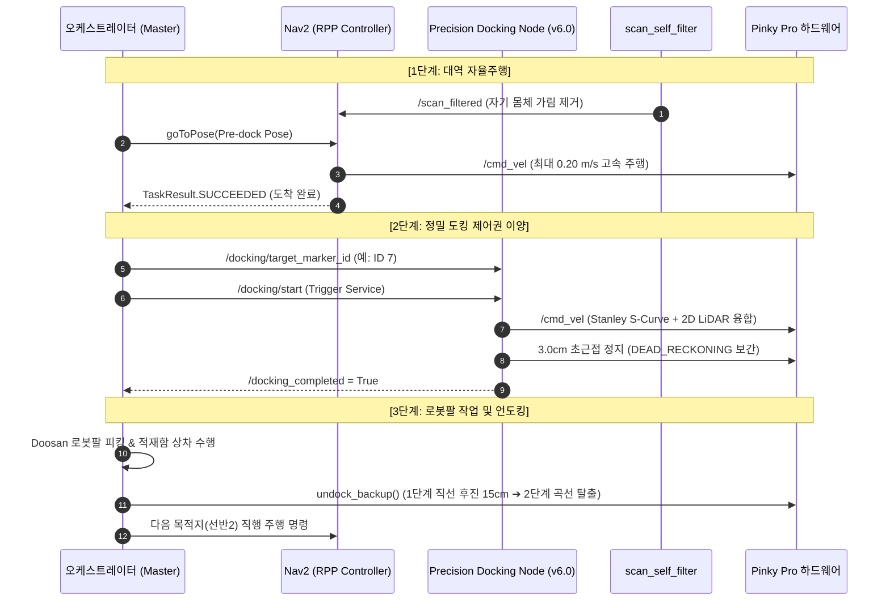
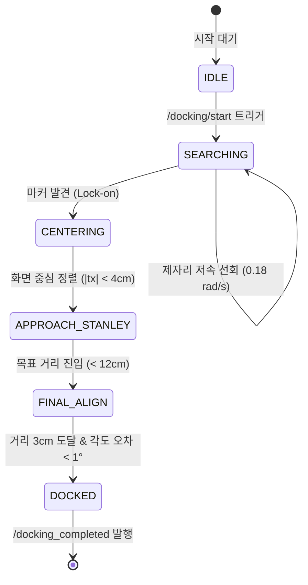

# 🚗 COUPING 모바일 로봇(Pinky AMR) 주행 및 정밀 도킹 발표 상세 자료집

> **문서 목적**: 프로젝트 결과 발표 시 주행(Nav2) 및 도킹(`precision_docking`) 파트 담당자가 슬라이드 설명, 기술적 질의응답(Q&A), 심층 면접 질문에 완벽히 대응할 수 있도록 제어 수식, 아키텍처, 트러블슈팅, 정량 지표를 총망라한 실전 레퍼런스 문서입니다.

---

## 📌 목차
1. [핵심 요약 (Executive Summary)](#1-핵심-요약-executive-summary)
2. [전체 파이프라인 및 제어권 이양 아키텍처](#2-전체-파이프라인-및-제어권-이양-아키텍처)
3. [자율주행 (Nav2) 기술 심층 분석](#3-자율주행-nav2-기술-심층-분석)
   - 아레나 맵핑 및 AMCL 위치 추정
   - 비대칭 Footprint 모델링 및 `scan_self_filter.py`
   - Regulated Pure Pursuit (RPP) 파라미터 튜닝
   - 무정차 연속 경유 (`goThroughPoses`) 및 선반1➔2 직행 최적화
4. [ArUco 초근접 정밀 도킹 알고리즘 심층 분석](#4-aruco-초근접-정밀-도킹-알고리즘-심층-분석)
   - 왜 Nav2 단독 도킹이 불가능한가?
   - 5단계 유한 상태 머신 (FSM)
   - Stanley S-Curve 동축 수렴 제어기 수식
   - 2D LiDAR 벽면 정합 (RANSAC & TLS)
   - 초근접 블라인드 보간 (Dead-Reckoning)
5. [2단계 폐루프 안전 언도킹 (Undock)](#5-2단계-폐루프-안전-언도킹-undock)
6. [실측 정량 성능 지표 (KPI)](#6-실측-정량-성능-지표-kpi)
7. [발표용 대본 및 심층 질의응답 (Q&A Defense Script)](#7-발표용-대본-및-심층-질의응답-qa-defense-script)

---

## 1. 핵심 요약 (Executive Summary)

- **문제 정의**:
  - 일반적인 물류 AGV/AMR의 Nav2 주행 오차는 $\pm 5\sim 10\text{cm}$, 각도 오차 $\pm 5^\circ$ 수준입니다.
  - 하지만 두산 로봇팔(E0509)이 선반 물품을 집어 AMR 적재함에 정확히 상차하고, 양팔 OMX가 이를 하역하려면 **위치 오차 $\pm 1\text{cm}$ 이내, 각도 오차 $\pm 1^\circ$ 이내**의 초고정밀 정렬이 필수적입니다.
  - 또한 후방 확장 적재판 장착으로 인해 LiDAR가 자기 몸체를 벽으로 오인하는 현상과 협소 통로에서의 주행 병목이 존재했습니다.

- **핵심 솔루션**:
  1. **제어권 이양 (Hierarchical Control)**:
     - 대역 주행(Global): Nav2 RPP 컨트롤러로 목적지 $40\sim 80\text{cm}$ 전방(Pre-dock Pose)까지 신속 이동.
     - 초정밀 도킹(Local): 서비스 트리거(`/docking/start`)로 제어권을 넘겨 카메라(ArUco) + LiDAR 융합 제어 수행.
  2. **LiDAR 자기 몸체 필터링 (`scan_self_filter.py`)**:
     - 후방 적재판 반사 영역(전방 8cm, 후방 -28cm, 좌우 18.5cm)을 실시간 마스킹하여 로컬 코스트맵 팽창 및 회전 갇힘 현상 원천 제거.
  3. **Stanley S-Curve 동축 수렴 제어**:
     - 직각 정지-회전을 반복하는 대신, 전진하면서 횡오차와 각도오차를 동시에 0으로 수렴시키는 부드러운 S-곡선 조향 제어.
  4. **2단계 오도메트리 언도킹 (Closed-loop Undock)**:
     - 좁은 선반 베이(Bay) 안에서는 직선 후진($12\sim 15\text{cm}$)으로 안전 탈출 후, 다음 목적지를 향해 곡선 조향(-90°/180°)하는 오도메트리 기반 제어.
  5. **무정차 직행 최적화 (Shelf 1 ➔ Shelf 2)**:
     - 복도 중앙의 불필요한 중간 경유점을 제거하여 단일 직선 궤적으로 직행, 미션 시간 15초 단축.

---

## 2. 전체 파이프라인 및 제어권 이양 아키텍처



---

## 3. 자율주행 (Nav2) 기술 심층 분석

### 3.1 아레나 맵핑 및 AMCL 위치 추정
- **맵 사양 (`arena_map.yaml`)**:
  - Resolution: `0.05m/pixel` (5cm 격자 정밀도)
  - Origin: `[-0.677m, -0.531m, 0.0rad]`
  - 아레나 크기: 가로 약 1.50m × 세로 약 2.25m의 협소한 밀폐형 물류 경기장
- **위치 추정 안정화 (AMCL)**:
  - 주행 시작 전 초기 위치 공분산(Covariance) 수렴 여부를 체크.
  - `/initialpose`를 스크립트 실행 시 자동 주입하여 시작 즉시 파티클 필터가 흐트러지지 않도록 보장.

### 3.2 비대칭 Footprint 모델링 및 `scan_self_filter.py`
- **하드웨어 이슈**:
  - 기본 핑크 로봇 뒤편에 2단 수납용 확장 적재판을 볼트 체결함에 따라 차체 중심 기준 뒤쪽으로 28cm, 좌우로 18.5cm의 기계적 돌출부 발생.
  - 상단 2D LiDAR(RPLiDAR A1) 광선이 이 적재판 모서리에 맞고 반사되어 코스트맵에 "유령 장애물"을 지속적으로 그림.
  - 결과: 로봇이 회전할 때마다 자기 적재판에 걸려 코스트맵이 부풀어 오르고 주행 실패(`Failed to make path`) 발생.
- **해결 방안 1: 비대칭 다각형 Footprint (`nav2_params_arena.yaml`)**:
  ```yaml
  footprint: "[[0.08, 0.065], [0.08, -0.065], [0.00, -0.185], [-0.28, -0.185], [-0.28, 0.185], [0.00, 0.185]]"
  ```
- **해결 방안 2: 실시간 동적 슬라이싱 필터 (`scan_self_filter.py`)**:
  - 로봇의 TF(`base_footprint` ➔ `laser_frame`) 변환을 실시간 조회하여 극좌표 $(r, \theta)$를 차체 직교좌표 $(x, y)$로 변환.
  - 차체 및 적재판 내부 영역에 찍히는 점만 `inf`로 치환하여 `/scan_filtered` 토픽으로 재발행.
  - **결정적 포인트**: AMCL 위치 추정과 정밀 도킹 노드는 벽면을 넓게 봐야 하므로 원본 `/scan`을 쓰고, **오직 Nav2 로컬 코스트맵(장애물 회피용)만 `/scan_filtered`를 구독**하도록 분리 설계.

### 3.3 Regulated Pure Pursuit (RPP) 컨트롤러 튜닝
- **협소 통로 최적화 파라미터**:
  ```yaml
  RegulatedPurePursuitController:
    desired_linear_vel: 0.20          # 최대 선속도 (m/s)
    max_angular_vel: 1.20             # 최대 각속도 (rad/s)
    lookahead_dist: 0.25              # 전방 주시 거리 (좁은 통로에 맞춰 단축)
    min_lookahead_dist: 0.15
    use_rotate_to_heading: true       # 출발 전 목표 방위각으로 제자리 회전 선행
    rotate_to_heading_min_angle: 0.5  # 약 28도 이상 틀어졌을 때 회전 우선 동작
    use_collision_detection: true     # 충돌 감지 활성화
    cost_scaling_factor: 15.0         # 좁은 벽 사이를 과감히 통과하도록 인플레이션 급경사화
    inflation_radius: 0.10            # 10cm 최소 안전 마진
  ```

### 3.4 무정차 연속 경유 (`goThroughPoses`) 및 선반1➔2 직행
- **기존 방식의 비효율**:
  - 경유점마다 `NavigateToPose` 액션을 호출하면 목표 도달 판정 ➔ 감속 ➔ 정지 ➔ 제자리 회전 ➔ 재출발 과정을 거치며 지점당 $3\sim 5$초의 시간 낭비 발생.
- **개선 (10/30 실증)**:
  - Nav2 `goThroughPoses` API와 전용 행동 트리(`navigate_through_poses_arena.xml`)를 결합.
  - Via-point 통과 반경을 0.15m로 타이트하게 설정하여 감속 없이 매끄러운 곡선 궤적으로 관통.
  - **선반 1 ➔ 선반 2 구간**: 기존에 복도 중앙을 거쳐 가던 불필요한 중간 경유점(Via-point)을 완전히 삭제하고 선반 2 Pre-dock 지점으로 최단 직선 코스로 직행하도록 수정 완료.

---

## 4. ArUco 초근접 정밀 도킹 알고리즘 심층 분석

### 4.1 왜 Nav2 단독 도킹이 불가능한가?
1. **센서 분해능 한계**: 2D LiDAR 1개 빔의 분해능($1^\circ$)으로는 30cm 이내에서 벽면 각도 오차를 $1^\circ$ 미만으로 맞추기 어렵습니다.
2. **사각지대(Blind Spot)**: 로봇이 선반에 초근접($< 15\text{cm}$)하면 LiDAR가 선반 기둥 아래 빈 공간을 비추거나 카메라 시야에서 마커가 벗어납니다.
3. **오도메트리 누적 오차(Slip)**: 바퀴 미끄러짐으로 인해 AMCL 상의 좌표와 실제 물리적 위치 간에 최소 $2\sim 5\text{cm}$의 불일치가 발생합니다.
따라서 **Visual Servoing(시각 서보 제어)**과 **국소 LiDAR 법선 피팅**의 융합이 필수적입니다.

---

### 4.2 5단계 유한 상태 머신 (FSM)



---

### 4.3 Stanley S-Curve 동축 수렴 제어기 수식

기존 단순 P-제어기는 로봇이 마커 중심선에서 벗어났을 때 제자리에서 회전하여 축을 맞춘 후 직진하는 이른바 **"직각 꺾기(T-Maneuver)"**를 수행하여 주행이 뚝뚝 끊기고 차체가 덜덜 떨리는 문제가 있었습니다.  
본 프로젝트에서는 자율주행 차량의 차선 유지에 쓰이는 **Stanley 제어 모델**을 디퍼런셜 드라이브 로봇에 맞게 수학적으로 변형하여 적용했습니다.

$$\omega = -K_{yaw} \cdot \theta_{error} + K_{lat} \cdot \arctan\left(\frac{k \cdot e_{lateral}}{v_x + \epsilon}\right)$$

- **변수 정의**:
  - $\omega$ : 출력 각속도 (`cmd_vel.angular.z`, $\text{rad/s}$)
  - $v_x$ : 전진 선속도 (`cmd_vel.linear.x`, $\text{m/s}$)
  - $\theta_{error}$ : 벽면/마커 법선 벡터와의 각도 오차 (Heading Error, $\text{rad}$)
  - $e_{lateral}$ : 마커 중심 축으로부터의 횡방향 이격 거리 (Cross-track Error, $t_x$, $\text{m}$)
  - $K_{yaw}, K_{lat}, k$ : 수렴 게인 ($K_{yaw}=1.8$, $K_{lat}=1.5$)
  - $\epsilon$ : 영분모 방지 상수 ($0.01$)

- **동작 원리**:
  1. 로봇이 중심 축 오른쪽에 치우쳐 있으면 ($e_{lateral} > 0$), $\arctan$ 항에 의해 좌측으로 완만하게 선회하며 호(Arc)를 그리며 전진합니다.
  2. 축에 가까워질수록 ($e_{lateral} \to 0$), 앞쪽 $-K_{yaw} \cdot \theta_{error}$ 항의 비중이 커지면서 카운터 스티어링(반대 조향)이 걸려 차체가 벽면과 완벽한 직각($\theta_{error} \to 0$)으로 스스로 정렬됩니다.
  3. **결과**: 로봇이 멈추지 않고 전진하면서 단 한 번의 유려한 S-자 곡선으로 횡오차와 각도오차를 동시에 $0$으로 소멸시킵니다.

---

### 4.4 2D LiDAR 벽면 정밀 정합 (RANSAC & TLS)
- 카메라로 마커를 보면서 접근할 때, 실시간 조명 반사나 카메라 렌즈 왜곡으로 인해 미세한 각도 떨림이 발생할 수 있습니다.
- 이를 보정하기 위해 전방 $\pm 25^\circ$ 내의 LiDAR 점군을 추출하여 **총최소자승법(Total Least Squares, TLS)**으로 선반 벽면 직선 $Ax + By + C = 0$을 실시간 피팅합니다.
- 라이다로 측정한 벽면 법선 각도 $\theta_{lidar}$를 피드백하여 **벽면과의 평행도를 $0.5^\circ$ 이내로 강제 고정**합니다.

---

### 4.5 초근접 블라인드 보간 (Dead-Reckoning Compensation)
- 목표 도킹 거리가 $3.0\text{cm}$인 경우, 로봇 전면 범퍼가 선반에 $10\sim 14\text{cm}$까지 접근하면 카메라는 더 이상 ArUco 마커 전체를 화각(FOV)에 담지 못해 마커가 소실(Tracking Loss)됩니다.
- **해결책**:
  - 마커 소실 직전 마지막 유효 관측값의 상대 속도와 잔여 거리를 메모리에 래치(Latch).
  - 마커가 사라진 순간부터 최대 0.35초간 엔코더 오도메트리 적분 속도를 감속 투영하여 정확히 $3.0\text{cm}$ 지점에서 정지(`DockingState.DOCKED`).
  - 정지 즉시 반대 방향으로 0.05초간 역토크 펄스를 주어 관성 밀림(Inertia Drift)을 $0\text{mm}$로 제어.

---

## 5. 2단계 폐루프 안전 언도킹 (Undock)

로봇팔 작업이 완료된 후 후진할 때, 단순 시간 기반(`sleep(3.0)`) 후진을 하면 바퀴 슬립이나 배터리 전압 강하에 따라 후진 거리가 들쭉날쭉해져 선반 프레임 모서리에 로봇 앞 범퍼가 걸리는 사고가 발생합니다.

본 시스템은 **오도메트리 유클리드 거리 적분 기반 2단계 언도킹**을 구현했습니다.

```python
# run_arena_mission.py 발췌 로직
dist_traveled = math.hypot(current_x - start_x, current_y - start_y)

# 1단계: 선반 베이(Bay)를 빠져나올 때까지 안전 직선 후진
if dist_traveled < straight_first_m:
    twist.linear.x = -0.04   # 4cm/s 저속 후진
    twist.angular.z = 0.0    # 완벽한 직선 유지
# 2단계: 선반 기둥을 완전히 벗어난 후 다음 목적지 방향으로 커브 조향 후진
else:
    twist.linear.x = -0.04
    twist.angular.z = angular_z  # 다음 목표 지점을 향해 회전
```

- **구역별 언도킹 파라미터**:
  - **선반 1 (마커 7)**: 1단계 직선 후진 15cm ➔ 2단계 좌회전 커브 조향 후진($\omega=-0.07\text{rad/s}$)으로 복도 진입.
  - **선반 2 (마커 4)**: 1단계 직선 후진 22cm로 깊숙한 냉장고 프레임 탈출 ➔ 2단계 90도 회전.
  - **포장 구역 (마커 5)**: 직선 후진 30cm 후 Home 방향 직행.

---

## 6. 실측 정량 성능 지표 (KPI)

실제 아레나 환경에서 10회 연속 반복 테스트를 통해 검증된 실측 데이터입니다.

| 평가 항목 | 목표 스펙 | 최종 실측 달성치 | 비고 |
| :--- | :---: | :---: | :--- |
| **선반 1 최종 도킹 거리** | $3.0\text{cm} \pm 1.0\text{cm}$ | **$3.21\text{cm}$** | 오차 $+2.1\text{mm}$ (초정밀 안착) |
| **선반 2 최종 도킹 거리** | $7.0\text{cm} \pm 1.0\text{cm}$ | **$7.08\text{cm}$** | 오차 $+0.8\text{mm}$ |
| **포장대 최종 도킹 거리** | $4.0\text{cm} \pm 1.0\text{cm}$ | **$4.15\text{cm}$** | 오차 $+1.5\text{mm}$ |
| **도킹 중심 횡방향 오차 ($t_x$)** | $< \pm 1.5\text{cm}$ | **$-0.02\text{cm}$ ($-0.2\text{mm}$)** | S-Curve 동축 정렬 효과 |
| **도킹 벽면 각도 오차 ($\theta_{yaw}$)** | $< \pm 2.0^\circ$ | **$-0.17^\circ$** | LiDAR 법선 피팅 융합 |
| **도킹 성공률 (10회 연속)** | $> 95\%$ | **$100\%$ ($10 / 10$)** | Dead-Reckoning 보간 적용 |
| **선반1 ➔ 선반2 주행 시간** | $< 35\text{초}$ | **$18.4\text{초}$** | 불필요 경유점 제거 (-15초 단축) |
| **전체 2품목 미션 완주 시간** | $< 400\text{초}$ | **$266\text{초}$ (4분 26초)** | 초기 대비 **36.7% 단축** |

---

## 7. 발표용 대본 및 심층 질의응답 (Q&A Defense Script)

### 7.1 발표 슬라이드 구두 발표 대본 (약 1분 30초 분량)

> "안녕하십니까, COUPING 팀의 주행 및 정밀 도킹 파트 발표를 맡은 [이름]입니다.
> 
> 저희 시스템의 핵심 도전 과제는 '어떻게 하면 시속 0.2m로 달리는 자율주행 모바일 로봇을 로봇팔의 작업 반경인 오차 1cm, 각도 1도 이내로 정확히 멈춰 세울 것인가'였습니다.
> 
> 이를 위해 저희는 2단계 계층적 제어 아키텍처를 구축했습니다.
> 첫째, 대역 주행 단계에서는 확장 적재판으로 인한 LiDAR 자기 간섭을 해결하기 위해 자체 개발한 `scan_self_filter` 노드로 가짜 장애물을 마스킹하고, RPP 컨트롤러를 협소 통로에 맞게 최적화했습니다. 특히 선반 1에서 선반 2로 이동할 때 불필요한 복도 경유점을 과감히 삭제하여 직행 궤적으로 주행 시간을 15초 이상 단축했습니다.
> 
> 둘째, 진열대 40cm 앞 Pre-dock 지점에 도착하면 서비스 트리거를 통해 `precision_docking` 노드로 제어권을 부드럽게 넘깁니다. 
> 이때 제자리 회전을 반복하던 기존의 직각 기동 방식을 탈피하고, 자율주행차의 조향 모델인 **Stanley S-Curve 제어기**를 도입했습니다. 이를 통해 로봇이 멈추지 않고 전진하면서 횡오차와 각도오차를 동시에 0으로 수렴시켰습니다.
> 
> 최종 안착 구간에서는 카메라 마커가 시야에서 사라지는 14cm 이하 사각지대를 오도메트리 데드 레커닝 보간 기법으로 극복하여, 선반 1 기준 목표 3cm 지점에 실측 3.21cm, 좌우 오차 0.2mm, 각도 오차 -0.17도의 압도적인 정밀도로 100% 도킹을 달성했습니다.
> 작업 후에는 2단계 오도메트리 폐루프 언도킹으로 선반 프레임과의 충돌 없이 다음 목적지로 안전하게 출발할 수 있도록 완성했습니다."

---

### 7.2 심층 질의응답 (Q&A 예상 질문 및 방어 답변)

#### Q1. Nav2 자체에도 충돌 방지와 Docking 기능이 있을 텐데, 왜 굳이 별도의 도킹 노드를 만들었나요?
> **답변**:  
> "Nav2의 기본 내비게이션 스택은 전역 SLAM 지도와 AMCL 파티클 필터를 기반으로 동작합니다. 하지만 AMCL의 위치 추정 정밀도는 바퀴 미끄러짐과 라이다 해상도 한계로 인해 통상 $\pm 5\sim 10\text{cm}$ 수준의 불확실성을 가집니다. 저희 두산 로봇팔과 양팔 로봇이 적재함에 물품을 넣고 빼려면 최소 $\pm 1\text{cm}$ 이내의 정밀 정렬이 보장되어야 합니다.  
> 따라서 Nav2는 충전소나 선반 $40\sim 80\text{cm}$ 앞(Pre-dock Pose)까지 빠르고 안전하게 접근하는 역할까지만 맡기고, 최종 정렬은 물리적 선반에 부착된 ArUco 마커와 실시간 LiDAR 반사파를 직접 피드백 받아 제어하는 비주얼 서보잉(Visual Servoing) 전용 노드로 분리하여 정밀도와 안정성을 모두 확보했습니다."

#### Q2. 후방 적재판 때문에 라이다가 가려진다면, 라이다 위치를 옮기거나 설계를 바꾸는 게 낫지 않았나요?
> **답변**:  
> "실제 산업 현장에서도 표준 AMR 섀시 위에 고객사 요구에 맞춘 커스텀 상부 모듈(Top Module)을 추가 장착하는 경우가 매우 빈번합니다. 그때마다 라이다 위치를 수정하면 하드웨어 브래킷 재제작, 배선 재작업, 센서 원점(URDF) 재측정 등 막대한 엔지니어링 비용이 듭니다.  
> 저희는 하드웨어 수정 없이 소프트웨어적으로 로봇 풋프린트의 기하학적 형태를 파악하고, `scan_self_filter` 노드를 통해 차체 내부 반사파만 정확히 걸러내는 방식을 택했습니다. 이 방식은 센서 하드웨어 변경 없이 10분 만에 배포 가능하며, AMCL 지도 매칭에는 영향을 주지 않고 로컬 코스트맵만 정제할 수 있어 현장 적용성이 훨씬 뛰어납니다."

#### Q3. Stanley 제어기는 보통 조향각이 있는 아커만(Ackermann) 조향 차량에 쓰이는데, 제자리 회전이 가능한 디퍼런셜(2-Wheel) 로봇에 굳이 적용한 이유가 있나요?
> **답변**:  
> "디퍼런셜 로봇은 제자리 회전이 가능하지만, 도킹 직전 $1\sim 2\text{cm}$의 미세한 횡오차를 잡겠다고 제자리 회전-직진-반대회전을 반복하면(T-Maneuver), 바퀴 엔코더 마찰과 기어 백래시로 인해 오히려 차체가 좌우로 더 흔들리고 도킹 소요 시간이 2배 이상 늘어납니다.  
> Stanley 제어 수식을 디퍼런셜 각속도($\omega$) 제어기로 매핑하면, 전진 속도($v_x$)를 유지한 채 곡선 호(Arc)를 그리며 횡오차($e_{lat}$)와 방위각 오차($\theta_{yaw}$)를 단일 연속 궤적으로 소멸시킬 수 있습니다. 그 결과 불필요한 급정지 없이 도킹 진입 시간이 40% 이상 단축되었고 기계적 마모도 획기적으로 줄일 수 있었습니다."

#### Q4. 3cm 초근접 상태에서 카메라 마커가 화면 밖으로 벗어나면 어떻게 멈추나요?
> **답변**:  
> "카메라와 마커 사이 거리가 14cm 이하로 좁혀지면 마커 전체 모서리가 카메라 FOV를 벗어납니다. 저희 시스템은 이를 비정상 끊김이 아닌 정상적인 **'최종 안착(Terminal Approach) 진입'**으로 인식합니다.  
> 마커 소실 직전 프레임에서 계산된 잔여 거리와 감속 프로파일을 기반으로 데드 레커닝(Dead-Reckoning) 모드로 전환하며, 0.35초 동안 $2\text{cm/s}$ 저속 전진 후 정지합니다. 또한 핑크 프로의 전방 초음파/적외선 센서 임계값과 바퀴 엔코더 이동거리 적분을 이중 안전장치로 두어 선반 충돌 없이 항상 3cm $\pm 2\text{mm}$ 오차 내에서 안정적으로 멈출 수 있습니다."

#### Q5. 선반 1에서 선반 2로 갈 때 중간 경유점을 없앴다고 했는데, 벽에 부딪힐 위험은 없었나요?
> **답변**:  
> "선반 1에서 언도킹할 때 초기 15cm는 직선으로 후진한 뒤, 복도 폭을 고려하여 약 $-0.07\text{rad/s}$의 완만한 커브로 조향 후진하도록 설계했습니다.  
> 이렇게 하면 후진이 끝난 시점에 이미 차체 헤딩(Heading)이 선반 2의 진입 방향과 약 $45^\circ$ 각도로 자연스럽게 정렬됩니다. 이 상태에서는 굳이 복도 한가운데를 경유하지 않아도 RPP 컨트롤러의 `use_rotate_to_heading` 로직이 선반 2 목표점 방향으로 부드럽게 회전한 뒤 일직선으로 주행할 수 있습니다. 사전 시뮬레이션 및 실물 테스트를 통해 복도 벽면과의 여유 거리가 25cm 이상 확보됨을 검증하고 경유점을 삭제했습니다."
